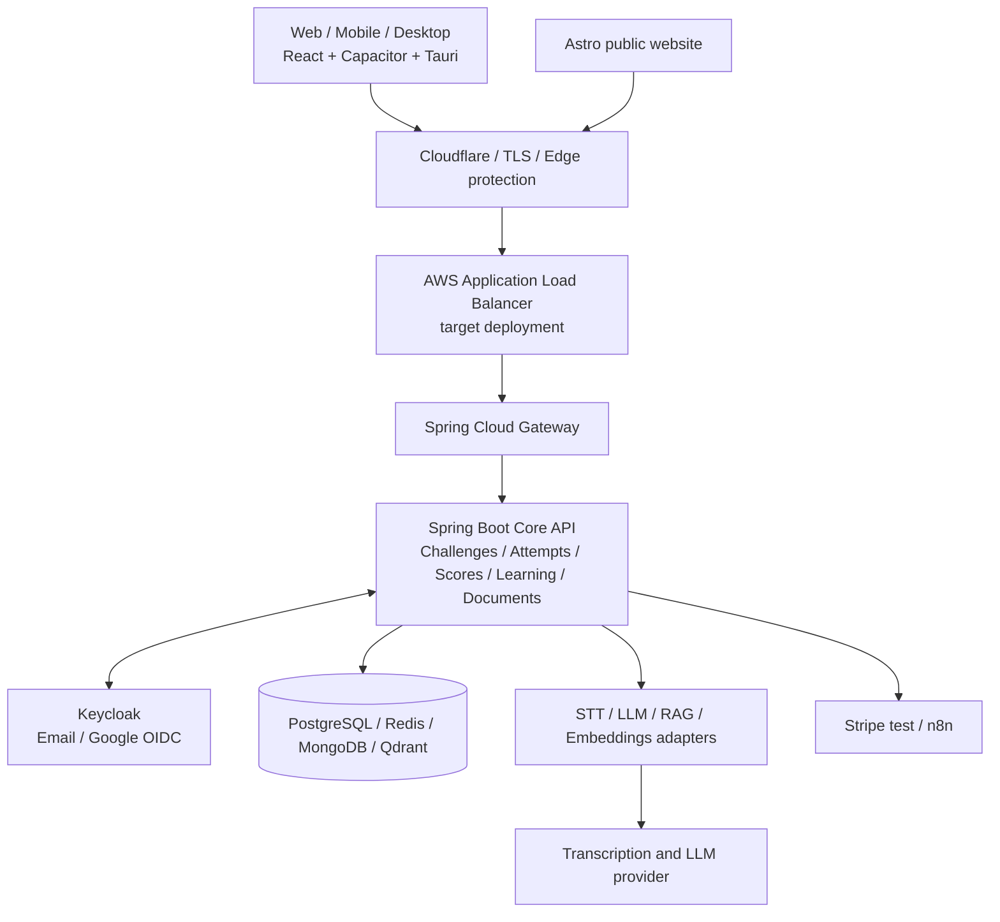

# SKILLCHECK

## Master Product & Technical Specification

**Improvement and Discovery of Soft Skills**  
**Version:** 1.0-RC1 | **Date:** 26 November 2026  
**Document role:** Single shared foundation for product, architecture, implementation and development agents.  
**Governing rule:** All mandatory requirements in Section 1 must be designed, implemented and verified. The optional item is explicitly distinguished.  
**Decision state:** Product scope is stakeholder-defined. Technical selections in the architecture are the team's **recommended working baseline**, subject to formal team ratification. No implementation, deployment or QA verification is claimed.

> **Single-source-of-truth policy.** This specification is self-contained. Every contributor and AI agent must read Section 1 before proposing code, infrastructure, data structures, diagrams or features. No external presentation or requirements attachment is needed to understand the mandatory scope. Where technical choices remain unratified, apply the recommended working baseline for planning and seek approval before implementing irreversible choices.

# 1. Binding Project Requirements

The following **26 requirements are mandatory** for SkillCheck. Their descriptions are reproduced **verbatim**, preserving their spelling, punctuation and spacing. The internal IDs R01–R26 enable traceability throughout this same specification; they do not change the content. The columns QA and PROD reproduce the marked evaluation environments. An `x` is a required-environment designation, **not evidence that implementation or testing has passed**.

## 1.1 Mandatory requirements (verbatim)

| ID | Exact requirement text | QA | PROD |
|---|---|:---:|:---:|
| **R01** | `Mono Repo` | x | x |
| **R02** | `Language programing and framework. 1 // Backend - Java Spring Boot. /// 1 Frontend ReactJs  Web` | x | x |
| **R03** | `Multiplatform // Web- Mobil - Desktop - Roles or permissions` | x | x |
| **R04** | `Microfrontends` | x | x |
| **R05** | `Segurity ----Cloudflare / KeyCloak / CORS` | x | x |
| **R06** | `Use AWS and any PAAS such --- Contenfull - Strapi- Supabase , etc` | x | x |
| **R07** | `Payment Gateway // stripe, paypal` | x | x |
| **R08** | `Testing ---Load Testing- Unit Testing. - Functional Testing - E2E - FrontEnd - BackEnd into CI/CD. /// Githubactions` | x | x |
| **R09** | `Docker- DockerHub` | x | x |
| **R10** | `Design Principles - at least 4 such as … SOLID - DRY - KISS -YAGNI - Encapsulation -Cohesion - Low Cupling - GRASP` | x | x |
| **R11** | `DataBase --  at least 4 DB and one must be cache and another one document.` | x | x |
| **R12** | `ApiGateway` | x | x |
| **R13** | `Load Balancer` | x | x |
| **R14** | `Methods of comunications - at least  3 include Restapi ----, SOAP, Restapi ,  - GRPC -  Webhooks, websocket Graphql ` | x | x |
| **R15** | `Architectures at least 2 -- MVC - MVVC -Hexagonal -  ` | x | x |
| **R16** | `Monitory - alerting -- sentry.io -- Site 24-7 ` | x | x |
| **R17** | `High availability` | x | x |
| **R18** | `Good documation such as Swagger, conventional commit, PR,readmes etc` | x | x |
| **R19** | `Use LLM or VLM ` | x | x |
| **R20** | `N8N ` | x | x |
| **R21** | `RAG` | x | x |
| **R22** | `Astro` | x | x |
| **R23** | `SDD , ODD` | x | x |
| **R24** | `WebAsembly` | x | x |
| **R25** | `Embeddings architecture` | x | x |
| **R26** | `Implement OWASP ` | x | x |

## 1.2 Optional requirement (verbatim)

The requirement below remains **optional**, even though QA and PROD have `x` marks. The optional heading takes precedence over those environment marks.

| ID | Exact optional requirement text | QA | PROD |
|---|---|:---:|:---:|
| **OPT-01** | `Implement SSR, SSG, ISR, and CSR when needed.  Using a framework like nextjs ` | x | x |

## 1.3 Requirement interpretation and acceptance rules

- **Scope lock:** R01–R26 are mandatory features or engineering constraints. They must not be dropped because a different stack is easier. If an ambiguity remains, record the risk and implement all unambiguous portions.
- **Explicit technology requirements:** R02 specifies Java Spring Boot and ReactJS; R06 requires AWS **and** a PaaS; R09 names Docker and Docker Hub. The solution architecture below includes all of them.
- **Minimum quantities:** R03 covers web, mobile and desktop with roles/permissions; R08 lists load, unit, functional and E2E test types across frontend/backend with GitHub Actions; R10 requires four or more design principles; R11 at least four databases including cache and document; R14 at least three communications; R15 at least two architectures.
- **Named examples and ambiguities:** R05 names Cloudflare, Keycloak and CORS; the working baseline implements all three. R14 provides several protocol names; the working baseline provides REST, WebSocket and webhooks while treating SOAP as a clarification item. R23 states `SDD , ODD` without defining the terms; do not fabricate meanings or mark R23 complete until clarified.
- **Evidence rule:** Design coverage does not mean implementation, QA or production completion. Evidence must exist for each relevant environment before claiming a requirement is delivered.

## 1.4 Mandatory requirement-to-design matrix

The table maps every requirement to a specific architecture component, implementation mechanism or unresolved acceptance condition. It is internal to this document; no other file is required.

| ID | Requirement | Required design / evidence | Technical area |
|---|---|---|---|
| R01 | Monorepo | One repository; pnpm workspaces + Maven multi-module | Architecture & platform |
| R02 | Java Spring Boot + React | Spring API and React web microfrontends | Architecture & platform |
| R03 | Web, mobile, desktop; permissions | React web + Capacitor + Tauri, USER/ADMIN | Client architecture & security |
| R04 | Microfrontends | Module Federation; bounded challenge/progress/admin modules | Architecture & platform |
| R05 | Cloudflare / Keycloak / CORS | Edge protection, OIDC authority, strict CORS | Security engineering |
| R06 | AWS + PaaS | AWS application tier, Supabase PostgreSQL/storage | Architecture & platform |
| R07 | Payment gateway | Stripe Checkout test-only, signed webhook | Architecture & platform |
| R08 | Testing and GitHub Actions | JUnit, Vitest, Playwright, k6; FE/BE gates | Platform engineering |
| R09 | Docker + Docker Hub | Image pipeline, versioned tagging, Compose and registry | Platform engineering |
| R10 | >=4 design principles | SOLID, DRY, KISS, low coupling and code evidence | Architecture & platform |
| R11 | >=4 databases incl. cache/document | PostgreSQL, Redis, MongoDB, Qdrant | Architecture & platform |
| R12 | API Gateway | Spring Cloud Gateway | Architecture & platform |
| R13 | Load balancer | AWS ALB PROD target; multi-replica local demo | System architecture |
| R14 | >=3 communications | REST, WebSocket and signed webhooks | System architecture |
| R15 | >=2 architectures | Hexagonal backend + MVVM frontend (+ Spring MVC adapter) | Architecture & platform |
| R16 | Monitoring and alerting | Errors, latency, storage, AI budget, signed events | Platform & security engineering |
| R17 | High availability | Target multi-AZ design and failover tests; funded target | Architecture & platform |
| R18 | Documentation process | OpenAPI, README, ADR, conventional commits, PR | Platform engineering |
| R19 | LLM or VLM | Structured clarity and coaching via provider adapter | AI & automation |
| R20 | n8n | Consent-filtered weekly practice reminder/report workflow | AI & automation |
| R21 | RAG | ACL-safe curated and user-private retrieval | AI & automation |
| R22 | Astro | Landing page and public documentation | Architecture & platform |
| R23 | SDD, ODD | **OPEN:** instructor expansion/interpretation required | Project governance / instructor clarification |
| R24 | WebAssembly | Rust/WASM waveform and silence feature extraction | Architecture & platform |
| R25 | Embeddings architecture | Versioned embeddings stored in Qdrant, deletion lifecycle | AI & automation |
| R26 | OWASP | OWASP Top 10 2025 + ASVS 5.0 control mapping | Security engineering |
| OPT-01 | Optional SSR/SSG/ISR/CSR | Deferred; not claimed as covered | Platform engineering |

**Coverage status:** The matrix describes planned design/evidence. None of the QA/PROD marks or described components proves a feature has been implemented, deployed, or validated.

# 2. Product Definition

## 2.1 Business objective and target users

**Mission.** Improve practical oral communication through repeatable exercises, transparent feedback and personalized coaching, while providing a single history of progress across web, mobile and desktop.

**Primary audience.** University students preparing for presentations, academic defenses and group communication; and job seekers preparing for interviews, self-introductions and workplace scenarios.

**Initial skill domain.** Spoken communication, including message structure, time management and filler-word control. The platform must not infer that a short recording can scientifically diagnose empathy, leadership, personality, anxiety or other psychological conditions.

**Primary outcomes.** Users can practice a real scenario in 60–90 seconds, receive a consistent 0–100 evaluation, understand the evidence behind their score, and access an improvement route tailored to their performance.

## 2.2 Product objectives and pilot success measures

1. Provide a complete challenge-to-feedback journey in Spanish and English, with the same essential capabilities on web, mobile and desktop.
2. Explain each score with measured duration, filler evidence, structured clarity criteria and a short actionable recommendation.
3. Track progress by skill and language, with an accessible history, rank evolution and targeted exercises.
4. Enable private, permission-aware retrieval of validated institutional materials and user-uploaded learning documents.
5. Validate the pilot against proposed metrics: at least 80% successful challenge completion, at least 70% positive feedback usefulness in a pilot survey, and p95 processing latency measured on actual test hardware. These are pilot targets, not contractual service levels.
6. Implement a test-only Premium checkout and verify entitlement changes through signed webhook events without real charges.

## 2.3 Personas and access roles

| Persona / role | Need | System permissions |
|---|---|---|
| Learner (USER) | Practice communication, see private feedback and upload supporting documents | Own attempts, history, saved audio and documents; free/Premium entitlements |
| Administrator (ADMIN) | Operate content, moderate approved reference materials and audit the platform | Manage challenge catalog, published knowledge, user status and non-sensitive operations |
| Teacher/content contributor | Provide teaching material for the shared knowledge library | Contribution occurs through an administrator-reviewed publishing workflow; no third production role is required initially |
| Visitor | Understand the offering | Public Astro website; no personal data access |

**Access principles.** Authorization is evaluated on the server. A USER can never read another learner's audio, transcripts, embeddings or documents. ADMIN does not receive blanket access to private learner audio as an ordinary product feature; extraordinary support access must be logged and justified.

## 2.4 Functional scope

| ID | Capability | Definition of functional completion |
|---|---|---|
| FR-01 | Identity and profiles | Register/login with email or Google; session lifecycle and USER/ADMIN roles |
| FR-02 | Challenge catalog | Filter by objective, difficulty and language; select a 60–90 s challenge |
| FR-03 | Recording | Device permission, visible timer, upload/retry, status and error handling |
| FR-04 | Evaluation | Transcription, duration and filler metrics, clarity feedback, weighted 0–100 score and rank |
| FR-05 | Personal learning paths | Recommendations backed by approved knowledge sources and historical performance |
| FR-06 | Knowledge upload | Upload and manage private documents; educator material enters only after review |
| FR-07 | Progress | Past attempts, language-specific progress, improvement milestones and rank history |
| FR-08 | Administration | Manage challenges and reference content; review operational metrics |
| FR-09 | Premium test checkout | Stripe test Checkout and verified webhook grant a demonstrator Premium entitlement |
| FR-10 | Privacy controls | Consent, retention selection, download/delete requests and access visibility |
| FR-11 | Multiplatform parity | Core features available in web, mobile and desktop clients with platform-specific permission testing |

## 2.5 Commercial definition

**Free:** Spanish speaking challenges, scoring, basic explanations, progress and a constrained set of recommendations.  
**Premium demonstrator:** English speaking challenges, specialized interview scenarios, extended learning paths and detailed progress insights.  
**Payments:** Stripe Checkout remains in test mode and must never use live API keys, live charges or a genuine paid subscription during the semester demonstration. The backend activates only a `DEMO_PREMIUM` entitlement from a verified test event.  
**Regional constraint:** Stripe's published payments availability list does not include Ecuador as a supported merchant country at the document date. This blueprint is a **technical sandbox demonstration**, not an authorization to launch live merchant processing in Ecuador.

# 3. Business Rules and Evaluation Policy

## 3.1 Challenge cycle

`Choose challenge → grant microphone permission → record 60–90 s → upload securely → transcribe → calculate measurable metrics → evaluate clarity → compute score → deliver feedback → recommend next challenge → retain result.`

Real-time text display is optional; final transcript and results are required after submission. Audio processing must remain recoverable after temporary network failures and must not duplicate an attempt if a user retries.

## 3.2 Scoring contract

**Defined product weighting:**

`Final score = 0.30 × Duration + 0.40 × Filler Control + 0.30 × Clarity`

Each component is normalized to 0–100. The resulting score is rounded to the nearest integer and bounded to [0, 100]. This weighting is a project business input; the component calibration below is **a technical proposal requiring product-owner acceptance and pilot validation**.

| Component | Initial deterministic / reviewable rule | Evidence |
|---|---|---|
| Duration (D) | D = max(0, 100 − 2 × seconds outside the inclusive 60–90 s interval). Perfect range receives 100 | Recorded media duration, not STT timestamps |
| Filler control (F) | Compute `fillers_per_100_words = 100 × confirmed_fillers / max(1, spoken_words)`; F = max(0, 100 − 12 × fillers_per_100_words) | Original transcript, normalized tokens and contextual filler spans |
| Clarity (C) | Structured independent rubric: main idea 40%, concrete example 35%, closing 25%; each criterion graded 0, 0.5 or 1 with cited textual evidence | Model output using a strict schema; confidence, prompt version and reviewer sample |

Filler lists are language-specific and context-aware. In Spanish, words such as `este`, `o sea`, `bueno` and `cómo decirlo` require contextual filtering. In English, `like` can be a meaningful word and must not be counted automatically. Empty or low-confidence transcripts are reported as `REVIEW_REQUIRED`, not scored as zero without explanation.

**Rank mapping (recommended working baseline):** Iron 0–19; Bronze 20–39; Silver 40–59; Gold 60–74; Platinum 75–89; Diamond 90–100. Rank thresholds must be validated with pilot users before formal release.

**Scoring invariants.** A failed transcription must not create a fabricated score. Only the backend calculates and persists official scores. Changes in model/prompt version must be tracked so a user's improvement is not confused with a scoring-system change.

## 3.3 Cross-platform and language parity

The same authenticated user, challenge catalog, score calculation and progress API apply to every client. Browser, Android/iOS and desktop packaging may have different microphone permission flows, but must not silently change the scoring method. Language-specific history and filler rates must remain separable in analytics.

# 4. Recommended System Architecture

## 4.1 C4-oriented system view



*Figure 1. Proposed container-level reference, to be refined into detailed C4 models during design. Cloud targets shown here are deployment intentions, not existing instances.*

**C4 context boundary:** SkillCheck serves learners and administrators; external systems include Google Identity, an AI transcription/LLM provider, Stripe test mode, external document sources and a cloud hosting provider.  
**C4 containers:** Web shell and microfrontends, Astro public website, mobile and desktop wrappers, Spring Cloud Gateway, SkillCheck Core API, Keycloak identity service, n8n automation service, databases and AI adapters.  
**Component-level ownership:** backend separates `identity-access`, `challenge-catalog`, `recording-attempts`, `evaluation`, `learning-paths`, `knowledge`, `billing-entitlements` and `admin-observability`.

## 4.2 Application structure and patterns

**Repository:** a single Git monorepo with `pnpm` workspaces for TypeScript projects and Maven multi-module support for Java services. The authoritative physical layout is defined once in **Section 12.2**; this section only maps the architectural components onto it:

| Architectural component | Physical location |
|---|---|
| Spring Cloud Gateway, Core API and asynchronous workers | Maven modules inside `apps/api/` |
| React shell and the challenges, progress and administration microfrontends | `apps/web/`, composed with Module Federation |
| Astro public site | `apps/site/` |
| Capacitor and Tauri packaging | `apps/mobile/`, `apps/desktop/` |
| Shared UI kit, contracts and shared client logic | `packages/ui/`, `packages/shared/` |
| Compose, cloud and registry configuration | `infra/` |
| Test strategy and suites | `tests/` |

No component needs an additional top-level folder: microfrontends are composed inside `apps/web/`, and backend services are Maven modules inside `apps/api/`.

**Architecture styles:** Hexagonal architecture for domain services (ports/adapters isolate persistence, AI vendors and payments), and MVVM for React screens (view components + typed view models/hooks + service adapters). Spring Web MVC controllers provide HTTP entry points; this is a complementary presentation-layer pattern, not a substitute for the two documented architectural styles.

**Frontend boundaries:** Module Federation enables independently maintained React microfrontends for challenges, progress and administration, composed by a React shell. Astro owns the SEO-friendly landing and public documentation, not the authenticated product. TypeScript UI components and domain types are reused in the Capacitor and Tauri packages, while the exact remote-module loading strategy must be tested on packaged clients.

**WebAssembly use case:** a dedicated Rust/WASM client module computes waveform amplitude, clipping/silence indicators and deterministic audio features before upload. It does not make the final score and must be benchmarked against a JavaScript baseline. The module gives R24 a genuine technical purpose.

## 4.3 Gateway, traffic and communication mechanisms

| Requirement | Recommended implementation | Contract / purpose |
|---|---|---|
| API Gateway | Spring Cloud Gateway | Central API routing, request IDs, endpoint-level quotas, route policy and observability |
| Load Balancer | AWS Application Load Balancer in target deployment | TLS routing, health checks and distribution across application replicas |
| Method 1: REST/HTTPS | Browser/packaged apps ↔ Spring Gateway/API | Identity-aware CRUD, catalog, attempts, scores, learning paths |
| Method 2: WebSocket/WSS | Gateway ↔ authenticated client | Asynchronous analysis status updates and progress event delivery |
| Method 3: signed webhooks | Stripe test → backend; backend → n8n | Verified payment-state and automation events with idempotent processing |

Webhooks and WebSockets are distinct communication methods; REST remains the primary synchronous API. SOAP is present among examples in R14 and requires instructor clarification only if it is mandatory in addition to the stated minimum of three.

## 4.4 Module ownership and key dependencies

| Module | Main responsibility | Dependencies |
|---|---|---|
| Identity & Access | Token validation, role/entitlement checks | Keycloak, PostgreSQL |
| Challenges | Catalog, difficulty, language, prompts | PostgreSQL, Redis |
| Attempts | Recording metadata, upload lifecycle, progress | PostgreSQL, Supabase private storage |
| Evaluation | Timing, fillers, clarity, rank and explainability | Transcription adapter, LLM adapter, PostgreSQL |
| Knowledge & RAG | Ingestion, ACL, chunking, embeddings and semantic retrieval | MongoDB, Qdrant, private storage |
| Learning Paths | Skill gaps, evidence-grounded next exercises | PostgreSQL, RAG, Redis |
| Billing & Entitlements | Stripe test session, verified webhooks, demo entitlements | Stripe test API, PostgreSQL |
| Automation | Scheduled audit and learning reminders | n8n; signed callbacks only |
| Administration | Challenge and reference-content publishing, operational views | Backend RBAC and audit events |

# 5. Technology Decisions and Alternatives

The following selections define the **recommended working architecture**. They form a consistent implementation proposal aligned with the binding requirements in Section 1; changes require documented team approval.

| Decision ID | Recommended selection | Rationale / alternative disposition |
|---|---|---|
| A-01 | Java 21 + Spring Boot + Maven | Directly satisfies R02. Node.js may be used for frontend build tooling, but the product backend remains Spring Boot. |
| A-02 | React + TypeScript + Vite | Required React frontend; typed contracts and lightweight build. |
| A-03 | React Module Federation + one UI kit | Real microfrontend boundaries without independent visual systems. |
| A-04 | Astro for landing/docs | Concrete role for R22 without duplicating the authenticated React app. |
| A-05 | Capacitor mobile + Tauri desktop | Shared capabilities with native packaging; each platform requires real mic tests. |
| A-06 | Keycloak OIDC + Google identity broker | Email/password and Google login, JWT/OIDC validation, USER/ADMIN RBAC. Supabase Auth is not the identity authority. |
| A-07 | PostgreSQL (Supabase), Redis, MongoDB, Qdrant | Four distinct data roles: transactions, cache, documents, vectors. No decorative databases. |
| A-08 | Spring Cloud Gateway + AWS ALB | Explicit API gateway versus load balancing responsibilities. |
| A-09 | REST + WebSocket + webhooks | Three meaningful methods aligned to client workflow and payment events. |
| A-10 | Hexagonal backend + MVVM frontend | Two architectural styles with implementation boundaries and testability. |
| A-11 | AWS compute target + Supabase PaaS | Satisfies both AWS and PaaS. Local Compose runs before account provisioning. |
| A-12 | Docker, Docker Hub, GitHub Actions | Required registry, portable containers and CI/CD. |
| A-13 | LLM/STT provider adapters + Qdrant RAG | Provider replacement, versioned prompts and retrieval isolation. |
| A-14 | n8n for scheduled learning communications | Concrete automation use case; keep privileged functions behind backend APIs. |
| A-15 | Stripe **test mode only** | Verifiable checkout integration without live transactions. |
| A-16 | Cloudflare, Keycloak, CORS + OWASP ASVS | Layered edge, identity and application security with evidence-driven controls. |
| A-17 | Rust/WASM audio feature extraction | Measurable client-side compute and a defined WASM interface. |
| A-18 | Four design principles: SOLID, DRY, KISS, low coupling | Evidenced by ports/adapters, reuse, thin services and bounded modules. |

**Optional rendering architecture (OPT-01):** Defer Next.js adoption. React handles CSR for authenticated views and Astro delivers static/server-rendered public pages as required. Do **not** claim the optional four-mode Next.js requirement is achieved unless all SSR, SSG, ISR and CSR behaviors are explicitly demonstrated and verified.

# 6. Four-Store Data Architecture

| Store | Ownership / stored data | Access and retention controls |
|---|---|---|
| PostgreSQL via Supabase (relational) | `users`, `profiles`, `roles`, `challenges`, `attempts`, `scores`, `learning_paths`, `entitlements`, `audit_index` | Primary business transactions; user-scoped reads via API; encrypted transport and backups subject to plan |
| Redis (cache / ephemeral state) | Challenge catalog cache, rate-limit counters, bounded processing-state cache, WebSocket coordination | TTL by data class; do not retain sensitive transcripts as durable records |
| MongoDB (document) | Extracted document text, structured chunk metadata, prompt/feedback versions and ingestion manifests | Tenant/user ownership, provenance, review status, deletion cascade |
| Qdrant (vector) | Versioned embeddings for approved global and user-private knowledge | Mandatory ownership filters, visibility labels, deletion by document ID and model version |

**Binary object storage:** Supabase private Storage buckets hold source audio and uploaded documents. Object storage is **not** counted as one of the four databases. Tokens, signed upload/download URLs, raw audio and confidential excerpts must not appear in log payloads. User file records in MongoDB and vectors in Qdrant refer to storage object IDs; deletion removes all derived artifacts.

**Boundary rule:** Clients never receive direct database administrator credentials. Each database has its own service identity, minimal permissions, health checks and a data lifecycle policy. Cross-database work uses immutable events and retryable asynchronous tasks, not fragile multi-store distributed transactions.

# 7. AI, RAG and Automation Design

## 7.1 Speech evaluation pipeline

1. Client records audio and requests an upload intent from the authenticated Spring API.
2. Server validates media type, duration, size and entitlement; private object storage receives the file.
3. A job is created with a unique attempt ID and a retry-safe idempotency key.
4. STT adapter transcribes the content and returns language, segments and confidence signals when supported. Recommended pilot provider: OpenAI `gpt-4o-mini-transcribe`; local Whisper-family inference is the zero-API-cost development fallback, subject to hardware availability.
5. The rules engine calculates exact media duration, word count and context-reviewed filler occurrences; it does not depend on a model to perform arithmetic.
6. A structured LLM prompt assesses the main idea, example and closing from transcript evidence. It must output only rubric fields and evidence spans, with model, prompt and rubric versions recorded.
7. The scoring service validates the component bounds, computes `0.30D + 0.40F + 0.30C`, assigns the rank and saves the attempt.
8. Learning-path service uses the user's weak criteria and approved RAG evidence to propose the next practical exercise; status is pushed through WebSocket and remains retrievable through REST.

**Cost policy.** A hosted STT/LLM endpoint is not assumed free. Apply explicit per-user rate limits and a monthly service budget ceiling of USD 0 before any API key is enabled. A teacher-provided or promotional credit may fund limited evaluation only after approval. Any local fallback must preserve the same API schema and clearly identify the inference method in results.

## 7.2 Retrieval-augmented recommendations

**Knowledge tiers:** (1) internal reviewed speaking and interview guidance; (2) teacher-supplied documents published only after administrator review; (3) documents privately uploaded by an individual user.

`Upload → malware/type/size checks → private storage → extraction → cleaning → chunking → embedding → Qdrant index with ACL metadata → semantic retrieval filtered by user/visibility → citations → recommendation.`

Required metadata: `document_id`, `owner_id`, `visibility`, `source_type`, `review_status`, `language`, `chunk_id`, `embedding_model_version`, `created_at`, `expires_at` and `deleted_at`. No teacher or user document becomes globally available solely because it was uploaded. Retrieved text is treated as **untrusted content**, not executable instructions; prompts must include citations and refuse unsupported conclusions.

## 7.3 Automation with n8n

A concrete first workflow: weekly practice-summary generation for opted-in learners, triggered by a signed backend event or scheduled job. The Spring backend prepares a minimal, consent-filtered payload; n8n delivers a reminder or report via an approved channel and logs only delivery status. No unrestricted n8n access to all private audio, MongoDB documents or raw credentials.

# 8. Security, Privacy and Reliability

## 8.1 Identity and permissions

Keycloak is the single OIDC authority. Email/password and Google sign-in are configured through Keycloak. Spring Security validates issuer, audience and signature on every protected call. Server-side RBAC enforces USER/ADMIN, while feature entitlements such as `FREE` and `DEMO_PREMIUM` remain business data, not security roles. Sensitive ADMIN endpoints require additional review, audit records and stronger session handling.

Cloudflare provides public DNS/TLS/edge security controls where the selected plan supports them. CORS is a strict allowlist of approved web origins and required methods; permissive wildcard origins must not be combined with credentials. Gateway and service-level throttles remain required independently of any third-party WAF plan.

## 8.2 Threat model and OWASP baseline

| Threat scenario | Required control / evidence |
|---|---|
| Learner accesses another learner's attempt or vectors | Object-level authorization tests; tenant filters enforced before vector retrieval |
| Forged or replayed Stripe webhook | Validate signature and timestamp; event-ID deduplication; test-mode-only entitlement rules |
| Malicious document instructs the LLM to leak private data | Treat retrieval as data, isolate instructions, output citations, enforce ACL before embedding/retrieval |
| Excessive audio uploads and AI requests | Size/duration caps, rate limits, quotas, idempotency and cost circuit breaker |
| XSS, injection and unsafe HTML | Input schema validation, parameterized queries, escaping, CSP and dependency scanning |
| Leaked user recording or signed storage URL | Private buckets, limited-lived URLs, least privilege, log redaction and deletion workflow |
| Account takeover and admin misuse | Secure session handling, OAuth redirect checks, strong admin policies, MFA proposal and audit trail |
| Vulnerable images, packages or exposed secrets | SBOM/dependency scanning, secrets scanning, container scanning, branch review gates |

Baseline: **OWASP Top 10 (2025)** for risk coverage and **OWASP ASVS 5.0** as a verification catalog, targeting **Level 2** for authentication, access control and sensitive-data components where feasible. Exact ASVS control IDs and verified results belong in the detailed security specification, not in this initial blueprint.

## 8.3 Audio and document retention

The product requires **configurable, limited audio retention**. Recommended policy: default **7 days**, learner-selectable **1–30 days**, private storage, explicit recording consent, automatic expiry jobs and an auditable delete request. Transcript, score and progress survive audio expiry only under the user's account retention settings. An account deletion job must remove objects, text, cached copies, vector re and derived indexes, including retry verification. Backup deletion windows and provider-specific data retention must be disclosed after providers are configured.

Only use audio for the declared feedback workflow. No biometric identity inference, covert voice profiling or training on learner recordings without separate consent. Legal review is required before launching a public service.

## 8.4 Availability and incident response

**Local/QA:** Docker Compose services can demonstrate health checks, restart behavior, gateway rules and multiple Core API replicas. This does not prove cloud high availability.  
**Target PROD:** AWS ALB distributing traffic across at least two independently deployed Spring API replicas in separate availability zones, with shared managed state, monitoring and a documented failover test. Keycloak and every stateful dependency must also have a recovery plan.  
**Proposed operational targets:** 99.9% application availability after funded deployment; initial RTO 4 hours and RPO 24 hours, subject to validation and the selected managed-database plan. These are target objectives, not existing SLAs.

Alerts cover failed analysis jobs, elevated error rates, gateway 5xx, failed webhooks, service saturation, low storage, backup failures and spending thresholds.

# 9. Environments, Cost Controls and Delivery Engineering

| Environment | Purpose | Operating policy |
|---|---|---|
| LOCAL | Build all services and four data stores; seed demo content | Docker Compose; no production data or real Stripe charges |
| QA | End-to-end, functional, unit, security, load and cross-platform tests | Isolated secrets, test-only events, synthetic audio; CI evidence retained |
| PROD-DEMO | Demonstrate the running, integrated system to stakeholders | Deploy only when accounts/credits exist; Stripe remains in test mode; state any deviations from HA target |
| PROD-TARGET | Document intended multi-AZ availability and recovery posture | Requires funded AWS/managed services, security review, SLO measurement and team sign-off |

**Budget gate.** The team budget is **USD 0**. Do not provision billable AWS ALB, EC2, public IPv4, multi-AZ databases, paid AI requests or paid monitoring services before establishing credits, a spending alarm and a named payer/approver. AWS promotional credits and free plans are conditional, with usage limits; they are not equivalent to an unconditional zero-cost production deployment.

**CI/CD quality gates:** pull request to protected branch, Maven build and JUnit tests, frontend lint/type-check/Vitest, contract tests, integration tests against local stores, Playwright web E2E, k6 smoke/load scenarios, dependency/container scans, Docker Hub image publishing with versioned tags, and staged deployment requiring approval. Formal evidence is required for both frontend and backend; platform packaging validation is a separate test job.

**Documentation rules:** `README.md`, OpenAPI/Swagger, ADRs, C4 diagrams, Conventional Commits, reviewable pull requests, change logs and requirement traceability. Use repositories explicitly authorized for this product; never assume a personal training repository is the project repository.

# 10. Decision Governance and Risks

## 10.1 Team approval register

| ADR / question | Current recommended position | Required decision owner |
|---|---|---|
| ADR-0001 Monorepo and collaboration baseline | Single repository; GitHub Flow with protected `main` and short-lived Jira branches | Team / repository owner |
| ADR-0002 Product scope and plans | Spanish Free; English Premium test; equal primary features on all 3 platforms | Product Owner / team |
| ADR-0003 Backend architecture | Java Spring Boot is the mandatory core API technology | Technical team |
| ADR-0004 Client architecture | React microfrontends + Astro + Capacitor + Tauri | Technical team |
| ADR-0005 Identity and security | Keycloak + Google OIDC, Cloudflare, strict CORS, RBAC | Technical/Security reviewers |
| ADR-0006 Data and AI | Four stores with Qdrant RAG and provider-independent AI | Technical/AI reviewers |
| ADR-0007 Networking | Spring Cloud Gateway, AWS ALB, REST/WSS/webhooks | Architecture reviewers |
| ADR-0008 Delivery and cost | Local/QA first, AWS credits review, funded HA target separate | Product Owner / cloud owner |
| ADR-0009 Data lifecycle | Audio default 7d, selectable 1–30d; deletion cascades | Product Owner / Security reviewers |
| ADR-0010 Evaluation rubric | Weights fixed 30/40/30; scoring subscale formula piloted and calibrated | Product Owner / AI reviewer |
| ADR-0011 Payment demonstration | Stripe test-mode only, simulated entitlement, no real revenue | Product Owner / legal reviewer |

**ADR identifier convention:** decision identifiers use four digits (`ADR-0001`, `ADR-0002`, …). Only `ADR-0001` currently has a versioned file in `docs/decisions/`; the remaining identifiers are reserved for decisions still pending ratification. A row in this register is **not** evidence of approval, and a reserved identifier must not be treated as an approved decision.

## 10.2 Clarifications, assumptions and delivery risks

| ID | Risk or clarification | Treatment / release gate |
|---|---|---|
| EXT-01 | R23 `SDD , ODD` not defined | Ask instructor; do not invent the acronyms or mark coverage complete |
| EXT-02 | Whether SOAP and named security products are individually mandated | Confirm with instructor; design already covers 3 methods and all named security categories |
| RISK-01 | Zero-dollar budget versus real multi-AZ HA and paid inference | Never claim full PROD HA at zero cost; get credits/funding and verify pricing before deploy |
| RISK-02 | Four data stores increase operational complexity | Purposeful ownership, minimal instances in local/QA, managed options only when funded |
| RISK-03 | Microfrontends in packaged mobile/desktop builds | Test bundling, offline behavior, updates and WebView compatibility early |
| RISK-04 | Speech recognition may remove or misclassify filler words | Small annotated ES/EN validation set, original audio review and uncertainty reporting |
| RISK-05 | User-supplied RAG documents can leak data or contain injected instructions | ACL prefilter, private index separation, untrusted-context handling, redaction and delete propagation |
| RISK-06 | Stripe payment availability differs by country | Sandbox only; no live Ecuador billing claim or unauthorized merchant onboarding |
| RISK-07 | Project schedule and delivery cadence are not finalized | Product Owner confirms one project calendar and communicates milestones to all contributors |
| RISK-08 | Cloud/account ownership not yet established | Assign cloud owner, credit approval, secrets manager and decommission plan before provisioning |

**Sign-off record:** Product Owner: __________ | Technical Lead/Architect: __________ | Security Reviewer: __________ | Date: __________ | Decision: [ ] Approved  [ ] Amend and resubmit

# 11. Working Contract for Every Contributor and AI Agent

1. Read this **entire specification**, beginning with the complete mandatory requirements in Section 1, before generating architecture, code, tickets or recommendations. This file is sufficient as the common context for SkillCheck.
2. Distinguish **MANDATORY TEACHER REQUIREMENT**, **STAKEHOLDER PRODUCT DECISION**, **PROPOSED TECHNICAL BASELINE**, **TEAM-APPROVED ADR**, and **IMPLEMENTED/VERIFIED EVIDENCE**.
3. The product backend is **Java Spring Boot** in accordance with R02. JavaScript tooling is permitted for React and build tasks; do not substitute Node.js/Express for the required backend.
4. Do not reduce the platform to one SPA or one PostgreSQL database. Include microfrontends, Astro, WebAssembly and four purpose-specific databases.
5. Never invent the meanings of SDD/ODD; never convert optional Next.js-style rendering requirements into mandatory scope.
6. Keep the business contract: **students/job seekers; Spanish Free, English Premium demo; 60–90 s challenges; 30/40/30 score; web/mobile/desktop parity; private user and teacher-approved RAG content; configurable limited audio retention**.
7. Use **AWS + PaaS** as the intended architecture; do not claim a multi-AZ deployed system costs zero dollars. Never use real Stripe billing keys or real charges for the demo.
8. Treat audio, transcripts and uploaded documents as personal/private data. Validate authorization before database and vector retrieval. Never copy private data or secrets into agent prompts, logs or public documents.
9. Use this blueprint as the shared starting point for **any project task**. Apply the relevant requirements, architecture and approved ADRs without assuming task ownership or assigning work to a specific contributor. Do not change the project tracker, shared documentation or source repositories without explicit authorization.
10. When product behavior or architecture changes, update this master specification and its internal requirement traceability and approval register. Implementations must be reconciled with the current ratified version.

# 12. Shared GitHub Repository and Collaboration Workflow

**Official team repository:** https://github.com/Web-Programming-uce/Web-Programming-Doc-Work  
**Ownership:** SkillCheck project team (shared), not an individual role.  
**Status:** Proposed collaboration policy; repository settings and implementation still require verification.

The repository is where the team will keep the monorepo source code, CI configuration, documentation snapshots, architecture decisions and pull-request history. Confluence remains the shared product/requirement reference; Jira manages task assignments and delivery evidence; GitHub records code and review. Every PR should reference its Jira key and document any architectural change.

## 12.1 Branches and review

- **Method:** GitHub Flow, with a stable `main` and short-lived topic branches.
- **Method status:** this workflow is a **proposal for team ratification**, recorded in `ADR-0001`; `qa` and `prod` are environments and evidence gates, not long-lived branches.
- **Branch format:** `feat/WP-XX-topic`, `fix/WP-XX-topic`, `docs/WP-XX-topic`, `test/WP-XX-topic`, or `chore/WP-XX-topic`.
- **Conventional Commits:** e.g. `feat(WP-42): add challenge API`, `docs(WP-21): revise stack decision`.
- **Merge rule:** after the first authorized bootstrap, no direct pushes or force pushes to `main`; one review from a teammate and required CI checks for each PR.
- **Traceability:** reference Jira tasks, include test evidence and contract/security implications; resolve comments and update the task after merge.
- **Decision control:** business-rule or major architecture changes require explicit team approval and an ADR; published recommendations are not retroactive evidence of approval.

## 12.2 Monorepo directory model

```text
README.md
CONTRIBUTING.md
AGENTS.md
.editorconfig
.gitignore
.github/workflows/repository-checks.yml
.github/pull_request_template.md
docs/requirements/SkillCheck_Master_Specification.md
docs/sprint-1/
docs/workflow/
docs/decisions/
docs/architecture/
apps/api/       # Java 21 / Spring Boot, Maven modules (core API, gateway, workers)
apps/web/       # React shell + Module Federation microfrontends
apps/site/      # Astro landing/site
apps/mobile/    # Capacitor wrapper
apps/desktop/   # Tauri wrapper
packages/ui/    # shared design tokens and React components
packages/shared/ # OpenAPI-derived TypeScript clients, schemas and shared logic
infra/          # Docker Compose, AWS/PaaS, Docker Hub, Keycloak
tests/          # test strategy and suites
scripts/        # repository validation scripts
```

This tree is the **single authoritative folder model**; Section 4.2 maps the architectural components onto it. Folders marked for implementation are architectural placeholders, not running services. Node.js is a frontend build-time tool, **not** a substitute for the mandatory Java Spring Boot backend.

## 12.3 Quality, release and safety gates

- The initial GitHub Actions job validates documentation and the folder baseline; it does **not** claim frontend builds, backend tests, deployment or OWASP compliance.
- Future CI must include frontend and backend unit/functional checks, E2E, load, contract and security evidence; Docker and Docker Hub builds follow approved secrets and image-tag conventions.
- QA and PROD should be represented by distinct tested environments, secrets, approvals and evidence. Long-lived `qa`/`prod` branches are not necessary for this proposed GitHub Flow.
- Never commit passwords, API tokens, `.env` files, recordings, transcripts, private user documents or real Stripe keys.
- The repository administrator must initialize the empty repo, provision contributor permissions and activate branch protection.

## 12.4 Working procedure

1. Read the Master Specification and the relevant Jira issue.
2. Branch from `main` and make a focused change.
3. Run relevant tests, update versioned docs and propose an ADR when decisions change.
4. Open a PR, include Jira/Confluence links and test evidence, and request peer review.
5. Resolve comments, pass CI, merge and update Jira.
6. Coordinate changes in this Master Specification with the repository document snapshot.

**Important:** The more detailed initial repository procedure is versioned in `docs/workflow/GIT_WORKFLOW.md`. The initial repo was confirmed empty on 26 November 2026; this section describes the proposed engineering method, not an already implemented control.
