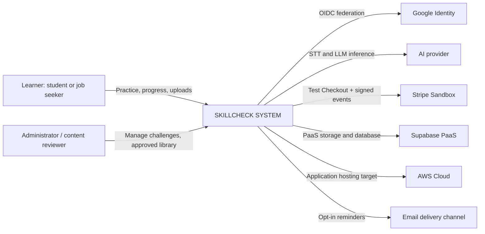
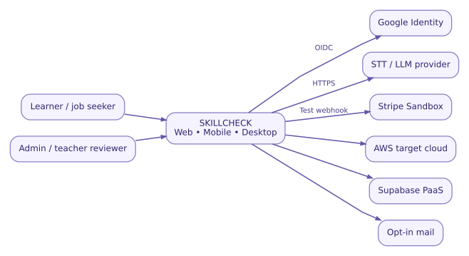
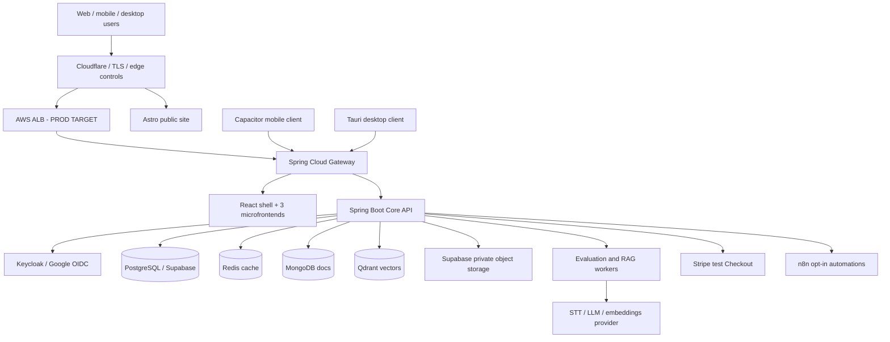
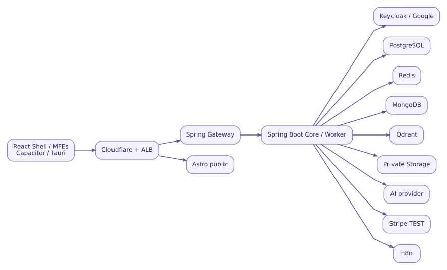
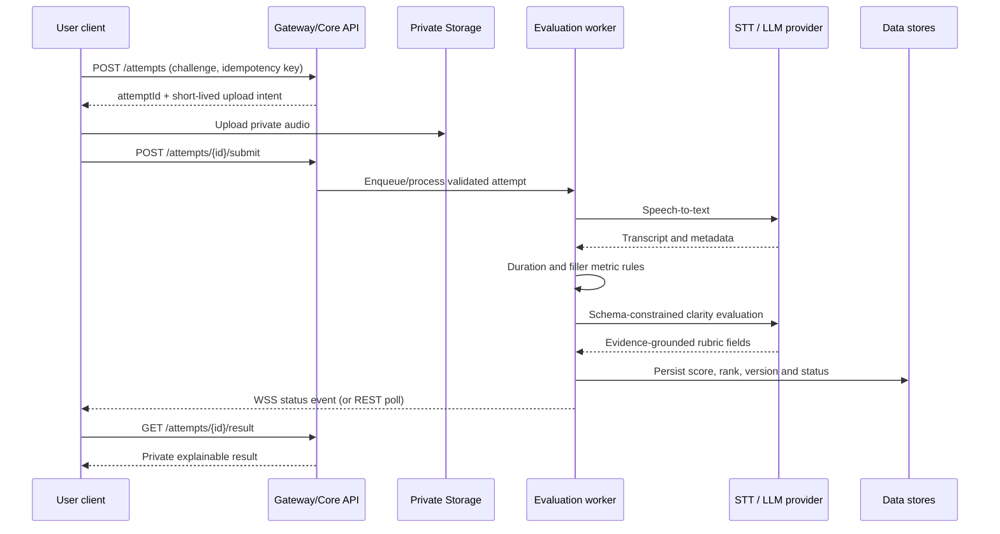
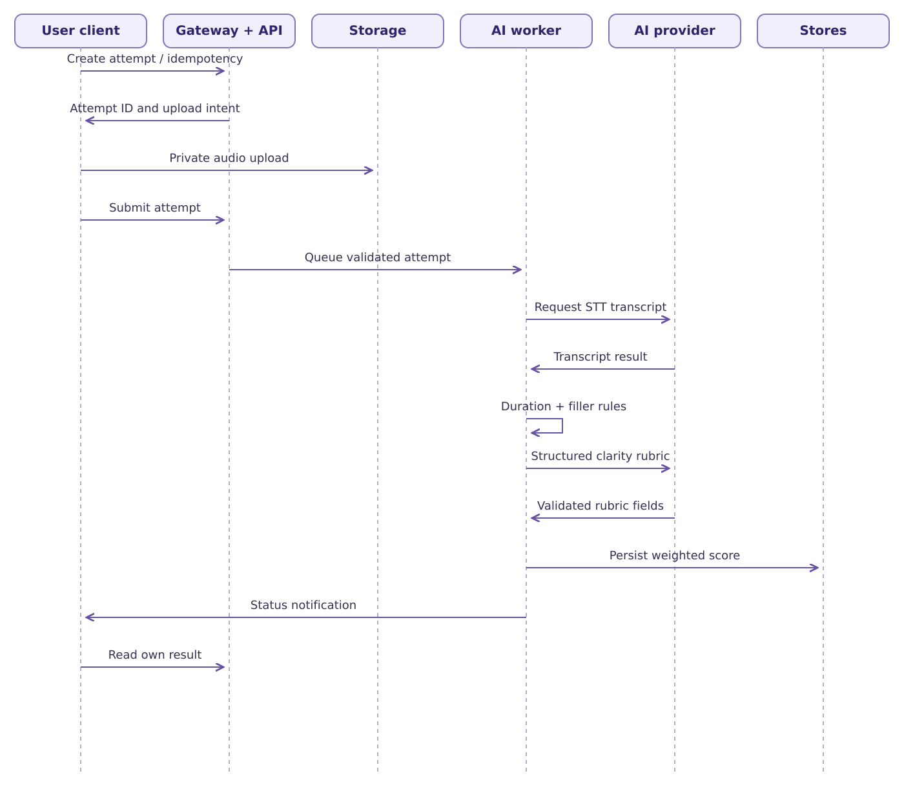
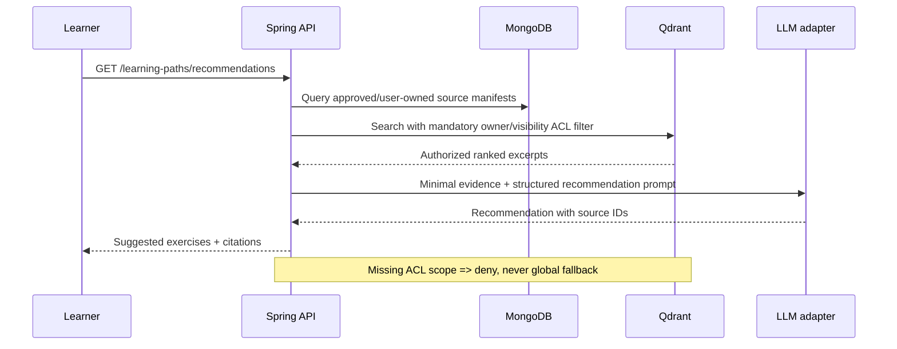
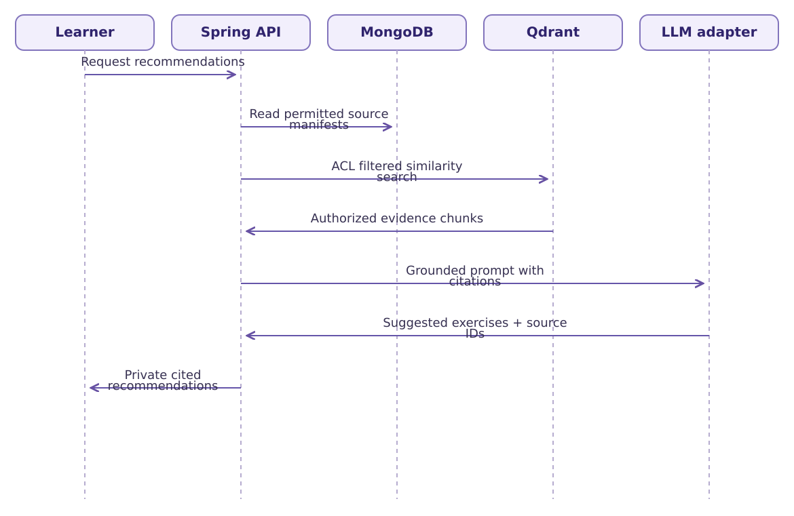
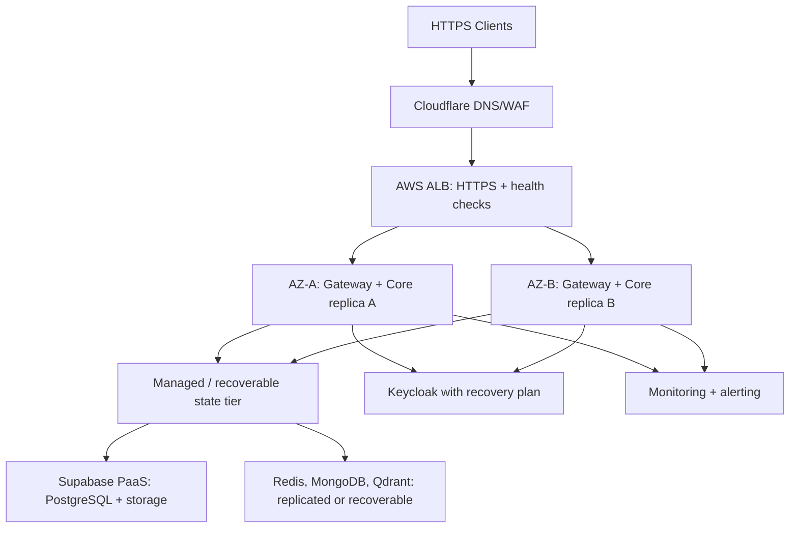
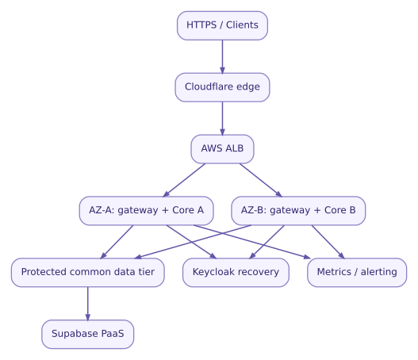

# WP-20 — System Architecture & Flow Diagrams

## C4 context, container, runtime sequences and deployment

**Project:** SkillCheck — Improvement and Discovery of Soft Skills  
**Work item:** WP-20 · System Architecture & Flow Diagrams  
**Owner:** Darwin Toapanta  
**Status:** **REVIEW-READY / DESIGN ONLY — pending team ratification**  
**Architecture baseline:** Java Spring Boot backend, React frontend, four data stores, provider-adapter AI, Keycloak and AWS+PaaS. Existing ticket wording that describes a Node.js server and Supabase Auth is **superseded as a technical proposal**, not as a change to the ticket. No Jira edit was performed.

## 1. Scope, boundary and design decisions

The C4 views describe the SkillCheck system as it should be implemented under the mandatory specification. The product provides Spanish Free / English Premium (sandbox-only) speaking challenges, scoring, progress, personalized RAG recommendations and privacy-controlled recordings across web, mobile and desktop. **Internal user content is not public; no frontend or AI provider directly accesses database administration credentials.**

| View | Purpose | Deliverable |
|---|---|---|
| C4 Level 1 · Context | Actors and external systems, system boundaries and trust | Figure 1 and system-context description |
| C4 Level 2 · Container | Deployable applications, stores and data flows | Figure 2 and component contracts |
| Runtime sequences | Recording/evaluation; protected RAG; checkout | Figures 3–4 and failure behavior |
| Deployment and operations | QA vs target AWS/HA topology | Deployment topology and release constraints |

**Notation:** solid arrows are intended communication paths; labels state the protocol. The figures represent **proposed design**, not currently running infrastructure. Where a data flow is asynchronous, REST remains the durable status lookup fallback.

## 2. C4 Level 1: System Context





*Figure 1 — System context: learners, administrators, SkillCheck and external systems.*

**System boundary:** includes client applications, authentication integration, business API, the internal knowledge retrieval workflow and automation. **External parties** include Google Identity, transcription/LLM provider, Stripe Sandbox, Supabase hosting platform, AWS infrastructure and an approved outbound email gateway. Keycloak is operated as an internal identity container, while Google remains an external identity provider.

**Personas and access:** Visitor (Astro public), USER (private attempts/documents), ADMIN (catalog/review and audits). Teachers contribute materials through the ADMIN review workflow; no direct blanket access to learner data. A privileged support workflow must be separately approved and logged.

## 3. C4 Level 2: Container Diagram





*Figure 2 — Containers: clients, edge, gateway, core API, identity, four stores, storage, AI, payments and automation.*

**Client-side composition:** React web shell combines challenge, progress and admin microfrontends with Module Federation. Bundled mobile/desktop clients reuse React screens and service contracts, but dynamic remote loading is evaluated per platform; packaged clients may bundle a versioned, integrity-tested composition. Astro is independent public content, not a fourth authenticated microfrontend.

**Backend internal components:** `identity-access`, `challenge-catalog`, `attempts`, `evaluation`, `learning-paths`, `knowledge-ingestion`, `billing-entitlements`, `operations`. A **modular Spring Boot application** keeps the runtime manageable while using hexagonal boundaries. `Spring Cloud Gateway` remains a separate edge application. Async workers may be hosted as a process profile/container of the same codebase; they do not require a different backend language.

### 3.1 Container / protocol ownership

| Container | Technology | Responsible for | Key interfaces |
|---|---|---|---|
| Public site | Astro | SEO, pricing as demo, help, legal disclosure | HTTPS |
| Web shell + 3 MFEs | React, TypeScript, Vite, Module Federation | Challenges, progress, administration | REST/WSS to gateway |
| Packaged clients | Capacitor, Tauri | Same core journeys on mobile and desktop | REST/WSS + microphone + OIDC |
| Identity authority | Keycloak + Google broker | Email, federated identity, USER/ADMIN roles | OIDC auth code+PKCE, JWKS |
| Gateway | Spring Cloud Gateway | Route policies, CORS, rate/connection bounds, observability | HTTPS, WSS |
| Core API | Java 21 Spring Boot | Business invariants and scoped authorization | REST controllers; webhook receivers |
| Evaluation worker | Java Spring Boot worker/profile | STT, filler analysis, clarity assessment, score persist | Internal job queue/polling, AI HTTPS |
| RAG worker | Java Spring Boot worker/profile | Extraction, chunking, embeddings, ACL retrieval | Internal HTTPS/jobs, vector search |
| 4-store data tier | PostgreSQL, Redis, MongoDB, Qdrant | Transactions, ephemeral cache, documents, vectors | Server private drivers |
| Private blob storage | Supabase Storage | Audio and uploaded files | Server-issued short-lived upload/download grants |
| Automation | n8n | Opt-in learning reminders, scheduled activities | Signed backend webhooks |
| Payments | Stripe Sandbox | Test checkout and events | HTTPS test API, signed webhook |

### 3.2 Port/adapters and database ownership

`Presentation (REST/WebSocket) → Application use cases → Domain policies → Ports → Adapters (identity, four stores, object storage, AI, billing)` is the hexagonal dependency direction. Domain logic does not import vendor SDK types. A learner never selects database ownership by changing a client-supplied `owner_id`; claims are derived from verified tokens on the server.

PostgreSQL commits attempts, ratings and entitlements. Redis stores TTL status, quotas and caches. MongoDB stores extracted source/document records and provenance. Qdrant stores user-filtered vectors. Blob storage is distinct and not counted among databases. Cross-store deletion is **eventual and auditable**, with a retry queue and tombstone guards.

## 4. Runtime sequence A: from recording to scored feedback





*Figure 3 — Runtime sequence A: upload, transcription, deterministic metrics, clarity evaluation and persisted score.*

**Failure behavior:** `CREATED → UPLOADED → PROCESSING → COMPLETED` or `REVIEW_REQUIRED/FAILED`. Network retries reuse the same attempt ID; no double scoring. Unknown language, empty/low-quality STT or unsupported media cannot produce a fabricated numeric score. Workers emit only non-sensitive operational logs. The backend computes `S = round(0.30D + 0.40F + 0.30C)` from validated 0–100 component values.

## 5. Runtime sequence B: private RAG and premium simulation





*Figure 4 — Runtime sequence B: ACL-prefiltered retrieval, grounded recommendations and the test-mode checkout boundary.*

**Checkout boundary:** `POST /billing/checkout/test → Stripe Checkout(test) → POST /webhooks/stripe` (raw-body signature verification) → event deduplication in PostgreSQL → grant `DEMO_PREMIUM`. Returning from the Checkout success URL **alone is never sufficient** to grant entitlement. No live key, live charge or external merchant onboarding is part of this semester demonstration.

## 6. Deployment, availability and cost model

### 6.1 Local/QA, the executable architectural target for Sprint planning

A Docker Compose stack includes Spring Gateway/Core/worker, Keycloak, PostgreSQL, Redis, MongoDB, Qdrant, n8n and supporting local object-storage/test service as needed. Astro and React are built/tested with pnpm and delivered as static artifacts. Keycloak test realm and fixed sample OIDC accounts are used. Synthetic audio/documents are mandatory for automated CI.

No account has yet been confirmed as provisioned. QA must demonstrate four-store integration, gateway routing, JWT validation, 3 communication methods, front/back test coverage and container images published to Docker Hub. A single laptop/VM is **not** evidence of high availability.

### 6.2 Target AWS production topology (requires funding)





*Figure 5 — Target AWS production topology: edge, ALB, two availability zones and shared recoverable state (requires funding; not provisioned).*

**Availability caveat:** two API replicas alone do not make SkillCheck highly available. Identity, databases, private storage, DNS, certificates, job processing and webhook deliveries need redundant operation or tested recovery. Proposed service objectives: 99.9% availability, RTO 4h, RPO 24h; these are **targets**, not measured SLA values. An AWS ALB and multi-AZ services can incur charges; a USD 0 budget prohibits provisioning without funding/credits and an account owner.

## 7. Logical repository and package contracts

The repository layout is defined once in the Master Specification (Section 12.2) and mirrored by the versioned folders:

```text
skillcheck/
  apps/api/       # Java 21 / Spring Boot, Maven modules (core API, gateway, workers)
  apps/web/       # React shell + Module Federation microfrontends
  apps/site/      # Astro landing/site
  apps/mobile/    # Capacitor wrapper
  apps/desktop/   # Tauri wrapper
  packages/ui/    # shared design tokens and React components
  packages/shared/ # OpenAPI-derived TypeScript clients, schemas and shared logic
  infra/          # Docker Compose, AWS/PaaS, Docker Hub, Keycloak
  tests/          # test strategy and suites
  docs/           # requirements, sprint deliverables, workflow, decisions, architecture
  scripts/        # repository validation scripts
```

**Component-to-folder mapping:** the Spring Cloud Gateway, the core API and the asynchronous evaluation/RAG workers are Maven modules inside `apps/api/`; the React shell and the challenges, progress and administration microfrontends are composed inside `apps/web/`; shared UI, contracts and i18n assets live in `packages/`. No separate top-level `services/` directory is used.

All packages build from **one Git repository**. Java uses Maven modules; TypeScript uses pnpm workspaces. API contracts are generated from OpenAPI and versioned. Changes across a contract and dependent client are reviewed in one pull request. Package creation and code implementation are future actions, not completed artifacts.

## 8. Required evidence, risks and review gates

| Requirement cluster | This design's coverage | Future verification artifact |
|---|---|---|
| R01–R04, R22, R24 | Monorepo, Spring/React, microfrontends, Astro, three clients, WASM | Build matrices, package install, platform mic/OAuth test, WASM benchmark |
| R05, R26 | Cloudflare, Keycloak, CORS, policy enforcement | Token rejection tests, cross-user IDOR tests, OWASP scans |
| R06, R12, R13, R17 | AWS+PaaS, gateway, ALB, target multi-AZ recovery | AWS config export, health tests, failover/report and approved funding |
| R07, R14 | Stripe test, REST/WSS/webhooks | Postman/contract tests, signed webhook replay tests |
| R08–R11, R15–R18 | CI, DockerHub, principles, 4 stores, 2 styles, monitoring | GitHub Actions run, image digests, arch review, dashboards |
| R19–R21, R25 | LLM, n8n, RAG and embeddings adapters | Evaluation fixtures, retrieval ACL tests, ingestion/delete evidence |
| R23 | SDD/ODD ambiguity | Instructor clarification required; do not claim resolved |

**Architectural risks:** (1) four-store operational load; (2) dynamic microfrontends in mobile WebViews; (3) STT removal of filled pauses; (4) OAuth origin/redirect variance; (5) private-RAG cross-user leaks; (6) zero-cost constraint versus true cloud HA; (7) provider cost/retention limitations.

### Deliverable acceptance checklist

- C4 context names users and all relevant external systems.
- C4 container view separates the React clients, Spring Gateway/Core, Keycloak, four stores, AI, Stripe and n8n.
- Two runtime sequences specify normal, error, authorization and asynchronous paths.
- Deployment view distinguishes local demo from funded production availability.
- Requirements R01–R26 are traceable to architectural concerns; R23 is explicitly open.
- All diagrams and components use Java Spring Boot rather than silently preserving an incompatible Node.js backend.

### References

- C4 model notation — https://c4model.com/
- Spring Cloud Gateway — https://docs.spring.io/spring-cloud-gateway/reference/intro.html
- Spring Security JWT — https://docs.spring.io/spring-security/reference/servlet/oauth2/resource-server/jwt.html
- Keycloak identity brokering — https://www.keycloak.org/docs/latest/server_admin/
- OWASP API Security — https://owasp.org/www-project-api-security/

**Review signature:** Product Owner __________ | Architect __________ | Security Reviewer __________ | Date __________  
**Jira status:** unchanged; this is a design deliverable, not implementation evidence.
