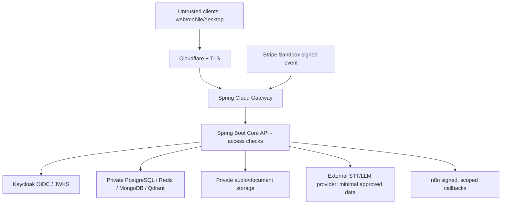
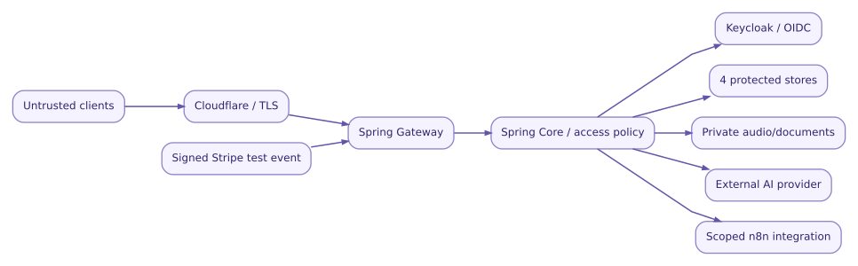

# WP-31 — Security & OWASP Implementation Guide

## Security controls, trust boundaries and verification criteria

**Project:** SkillCheck — Improvement and Discovery of Soft Skills  
**Work item:** WP-31 · Security & OWASP Implementation Guide  
**Owner:** Darwin Toapanta  
**Status:** **REVIEW-READY / CONTROL DESIGN ONLY — pending security approval**  
**Identity baseline:** **Keycloak** is the OIDC token issuer, federating Google; Spring Boot validates issued JWTs. Supabase remains the data/storage PaaS, **not a parallel authentication authority**. Earlier ticket wording that assumed Supabase Auth is superseded as a proposal, with no Jira change made.

## 1. Security objectives and threat model

SkillCheck processes microphone recordings, transcriptions, performance feedback, historical progress, learner documents, vectors and optional demonstration-payment events. Security must protect: **confidentiality** of user submissions, **integrity** of official scoring and Premium test entitlements, **availability** of challenge and feedback services, and **traceability** of administrative or consent decisions.

**Classification:** `PUBLIC` = Astro content and published general exercises; `INTERNAL` = service health and non-identifying metrics; `PRIVATE_USER` = recordings, transcripts, documents, embeddings, scores; `SECRET` = OAuth/API credentials, Stripe signing secrets and service account keys. No `PRIVATE_USER` data is included in public documentation, third-party analytics or default logs.

### 1.1 Trust boundaries

*Figure 1 — Trust boundaries: untrusted clients, edge, gateway, core API, identity, private stores, AI provider, payments and automation.*

The most sensitive boundaries are: (1) browser/client to gateway, (2) gateway to business authorization, (3) business API to private data stores, (4) application to external AI provider, (5) external Stripe to the entitlement service, and (6) uploaded documents to RAG and automation. Each boundary is authenticated and authorized independently. Hiding a button is not access control.

### 1.2 High-impact abuse cases

| Threat | Potential impact | Mandatory countermeasure |
|---|---|---|
| Change `userId` / attempt ID in API URL | Another learner's audio/results revealed (BOLA/IDOR) | Derive owner from verified token; object-level authorization for every query |
| Forged ADMIN role / mismatched JWT issuer | Catalog manipulation or data access | Validate signature, issuer, audience, time, roles and token type |
| Upload malicious file / oversized recording | Malware, parsing exploit, resource exhaustion | Content sniffing, size limits, scan, sandbox extraction, quotas |
| RAG prompt injection / cross-user retrieval | Private document leakage, manipulated recommendations | ACL filter **before** vector search, no tool execution from retrieval, source validation |
| Fake Stripe event / replay | Unauthorized Premium status | Verify raw-body signature, `livemode=false`, event type, order/session identity, dedupe |
| Automated STT job floods | Spend, denial of service | Per-account and platform quotas; circuit breaker and cost ceiling |
| Exposed object URL | Audio/document confidentiality breach | Private buckets, least-privilege grants, short TTL and no URL logging |
| Missing cleanup / deleted-user residual vector | Confidentiality and retention violation | Tombstones, cascade deletion with retries and verification |

## 2. Identity, OAuth2 and roles

### 2.1 Authentication model

**Keycloak** is the canonical OpenID Connect (OIDC) authority. Users sign in with **email/password or Google OAuth** brokered through Keycloak. Web uses authorization-code with **PKCE S256**; mobile and desktop use system browser/native-supported secure redirect flows, registered per app client. Each deployment environment has its own realm/client configuration and callback allowlists. Confidential client secrets reside only on servers; public mobile/browser clients do not embed long-term secrets.

**Spring Security resource-server JWT validation must enforce:**

1. JWT is correctly signed by an allowed Keycloak key, resolved via trusted HTTPS JWKS (with rotation handling).
2. `iss` matches the exact configured Keycloak realm issuer; issuer discovery and TLS must be trusted.
3. `aud` is intended for the SkillCheck API (not merely a token for another client); validate `azp`/authorized party where applicable.
4. `exp`, `nbf`, signature algorithm allowlist and clock skew are checked; reject missing/invalid claims.
5. Authorities are mapped from **approved realm/client role claims** to application `ROLE_USER` / `ROLE_ADMIN`, with least privilege.
6. Object-level permissions and Premium entitlement are checked against server-maintained domain data on each request; a stale token cannot alone grant a subscription.

**Token handling:** favor ephemeral access tokens in memory on web with appropriate server-side session protections, never browser `localStorage` for durable secrets without a reviewed threat model. Native secure OS stores hold refresh credentials where the OIDC SDK requires them. Use short-lived access tokens, rotation for refresh mechanisms, revocation/forced-logout workflow and MFA for administrators. Avoid passing tokens in WebSocket URLs or diagnostics.

### 2.2 Authorization matrix

| Resource / action | Visitor | USER (self) | ADMIN |
|---|:---:|:---:|:---:|
| Public Astro pages | Yes | Yes | Yes |
| Challenge list / own attempts | Public catalog only | Own | Administrative catalog; not private learner audio by default |
| Record / submit / see scoring | No | Own only | Own account only unless separately justified support access |
| Upload private knowledge | No | Own only | Own only; publish shared sources through reviewed workflow |
| Other learner's audio, transcript, vectors | No | **Deny** | **Deny by default** |
| Edit challenge catalog / approve shared content | No | No | Yes (audited) |
| Verify Stripe test webhook | No | No | Service identity only |
| View operational logs | No | No | Restricted operational subrole; secrets redacted |

Ownership is established through `sub`/internal user mapping **on the server**, never a user-submitted owner field. Database queries include owner constraints, Qdrant retrieval includes a pre-ranking ACL filter, and blob access uses short-lived signed grants minted only after authorization.

## 3. CORS, CSRF, headers and browser isolation

### 3.1 CORS policy (deployment examples, not live hostnames)

| Origin category | Behavior |
|---|---|
| `https://app.skillcheck.example` | Allowed for authenticated API routes once domain is approved |
| `https://admin.skillcheck.example` | Allowed only for admin-facing browser APIs with normal role validation |
| `http://localhost:5173` | LOCAL only; never present in public PROD allowlist |
| `null` or file:// | **Denied by default**; packaged clients use a specifically validated native/network model |
| `*` | Not allowed on credentialed/private API endpoints |

**Effective controls:** per-environment exact origin allowlist; methods `GET, POST, PUT, PATCH, DELETE, OPTIONS` only as needed; headers `Authorization`, `Content-Type`, request correlation/idempotency headers; no wildcard origins together with `Access-Control-Allow-Credentials: true`. Preflight replies contain correct `Vary: Origin`; do not reflect arbitrary origin strings. Login redirects require exact allowlists. Android/iOS Capacitor custom schemes and Tauri origins must be verified under their platform runtimes before adding them, rather than blindly permitting `*`.

**Cross-site request forgery:** an Authorization Bearer header API has different CSRF exposure from session-cookie endpoints. If browser session cookies are used, enforce CSRF tokens, SameSite and secure cookie settings. Do not disable CSRF globally without evaluating endpoint authentication. Strict Content Security Policy, `X-Content-Type-Options: nosniff`, HSTS (for production HTTPS), frame policy and restrained referrer policy apply to public/authenticated pages, adjusted for actual Module Federation assets and native wrappers.

## 4. Rate limiting and abuse prevention

**Layered policy:** Cloudflare edge abuse controls; Spring Cloud Gateway request quota; Spring Core domain-specific quotas; worker queue/cost circuit breaker. Illustrative **starting limits, not approved SLA**:

| Endpoint class | Suggested threshold | Additional defense |
|---|---|---|
| Login entry / password recovery | 5 attempts / 15 min per account+IP bucket | Keycloak native lockout and bot signals; no account enumeration |
| Catalog read | 120 requests / min / authenticated user | Burst allowance + Redis key TTL |
| Upload intent | 10 / hour / account | Byte, MIME, duration and entitlement validation |
| Analysis job submission | 5 / hour / Free; higher bounded demo Premium | One in-flight job, idempotency and max spend |
| RAG query | 30 / hour / account | Per-user token and retrieval budget |
| Admin mutation | 30 / min / privileged user | Audit and step-up authorization for sensitive actions |
| Public webhook | No simple user quota | Signed payload, replay/duplicate rejection, payload size and queue caps |

Limits should be tuned in QA based on load tests. Redis is a quota store, not the sole authorization decision-maker. In a Redis failure, selected high-cost or sensitive endpoints fail closed or fall back to safe bounded operation; failure mode must be specified and tested. Return HTTP 429 with safe Retry-After when appropriate; never reveal authentication validity through distinguishable throttling responses.

## 5. OWASP Top 10:2025 implementation matrix

The current official OWASP Top 10:2025 names the following categories. The table maps **specific SkillCheck controls and tests**, not merely category definitions.

| Risk | Implementation in SkillCheck | Verification / evidence |
|---|---|---|
| A01 Broken Access Control | Default-deny RBAC, owner-scoped PostgreSQL/Mongo queries, Qdrant ACL prefilter, object-storage grants after authorization | USER-A requests USER-B attempt/document → 403/404; non-owner vector retrieval returns zero |
| A02 Security Misconfiguration | Environment-specific CORS/CSP, least-privileged service accounts, secret externalization, secure defaults, no public DB ports | Config audit, OPTIONS origin tests, port scan and container configuration checks |
| A03 Software Supply Chain Failures | Lock files, reviewed dependencies, GitHub dependency checks, container image scanning, SBOM and verified release digest | PR CI artifacts, vulnerability triage, Docker Hub image digest evidence |
| A04 Cryptographic Failures | TLS in transit, at-rest encryption provider settings, trusted JWKS, short-lived storage grants, secret rotation | TLS/config tests, incorrect signature rejection, stored-secret inventory |
| A05 Injection | Parameterized SQL, safe document queries, validated inputs and output encoding; treat prompts/RAG data as untrusted | SQL/NoSQL/XSS payload suite, adversarial RAG fixtures |
| A06 Insecure Design | Threat model, privacy-by-design, usage quotas, tenant isolation, idempotent event workflow, no live billing | Architecture review, abuse-case acceptance suite, negative scenarios |
| A07 Authentication Failures | Keycloak OIDC+PKCE, verified JWT, admin MFA/lockout, refresh-session controls | Tampered/expired/wrong-issuer/wrong-audience token tests, login flow testing |
| A08 Software or Data Integrity Failures | Stripe signature/replay/idempotency, immutable artifact digests, versioned scoring models/prompts, trusted update channel | Webhook replay/fake signature, image provenance and model-version regression tests |
| A09 Security Logging & Alerting Failures | Correlation IDs, redacted audit events, alerts for repeated 401/403, token anomalies, failed deletion and runaway AI spend | Synthetic event raises alert; operator can trace without exposing personal data |
| A10 Mishandling of Exceptional Conditions | Fail-closed authorization, safe error responses, bounded retries, transactional score finalization, stable fallback polling | Fault injection: IDP outage, cache failure, malformed LLM JSON, third-party timeout |

**ASVS baseline:** use OWASP ASVS 5.0 as the verification catalog with an **L2 target for sensitive user and admin flows**, subject to team review. A complete control-ID matrix must be built against the exact ASVS 5.0 reference during implementation; **do not claim ASVS certification or full compliance from this document**.

## 6. Audio, uploads, document retrieval and AI privacy

**Recording consent and retention:** secure mic permission with visible recording indication; explicit consent for storing voice; configurable limited retention. **Proposed** default 7 days, selectable 1–30 days, with earlier user deletion. Only the necessary audio is sent to the chosen transcription provider after privacy/provisioning approval. Transcripts, scores and progress follow their own disclosed data-retention settings. Service/provider/backup retention must be reviewed before launch.

**Upload pipeline:** validate size/type and sniff content; extract documents in sandboxed process; reject active content; quarantine infected/unsupported content; restrict raw file access; maintain ownership and provenance metadata. File names are not trusted storage paths. Deleted or rejected documents must not remain in a vector retrieval index.

**RAG separation:** `GLOBAL_REVIEWED`, `TEACHER_REVIEWED`, `USER_PRIVATE`. A learner's uploaded PDF is **not** globally available or training data. SQL/NoSQL and Qdrant operations filter on verified user ID, visibility and document review status **before** any context is assembled for an LLM; rerank/citation steps repeat source authorization. No admin wildcard bypass is used in ordinary retrieval. Every deletion produces a tombstone that prevents access even while asynchronous cleanup proceeds.

**Prompt injection:** learning material and transcript text are untrusted content. The LLM receives a fixed system/developer instruction; source text is length-bounded and delimited as data; the model has no direct database, file-system or network tool permissions. Output is schema validated, and a suggestion without a permitted citation is rejected or marked uncited. A fake instruction inside user text cannot affect token verification, subscription status or score formula.

## 7. Payments, webhooks, n8n and secrets

**Stripe test Checkout:** create a test-mode session server-side; restrict session to authenticated user; accept only expected `checkout.session.completed` / relevant test event types. Verify `Stripe-Signature` against the **raw request body** and active signing secret, check `livemode == false`, session/customer binding, event freshness, unique event ID and entitlement state, and record an idempotent processing receipt in PostgreSQL. Never grant Premium on a browser redirect alone. `sk_test_*` and `whsec_*` are secrets, not frontend variables or repo values; `pk_test_*` is publishable but still environment-specific.

**n8n:** scheduled reminder only after user opt-in; an authenticated Spring integration endpoint provides minimum required summary. Signed callbacks, restricted service identity and idempotency prevent unauthorized actions. n8n must not hold Keycloak admin secrets or query private DBs directly. When outbound email service is absent, use a QA mail sink.

**Secret handling:** rotate via approved secret store, no hard-coded keys, environment separation, least-privileged access, PR secret scanning, cloud audit and prompt/log redaction. Do not copy sensitive signed Supabase URLs or OAuth headers into Jira, Confluence or an AI tool conversation.

## 8. Operational security, incident response and availability

- **Monitoring:** API 5xx/error budget, burst 401/403, repeated upload rejection, failed webhook signature, failed data deletion, worker queues, abnormal billable inference attempts and suspicious admin actions.
- **Log policy:** request correlation IDs and high-level event types; exclude full token, audio, transcript, document contents, provider secrets, signed URLs, sensitive headers and detailed model prompts.
- **Response playbook:** confirm and scope event → contain key/session/user risk → preserve sanitized audit evidence → rotate affected secrets → remediate → validate and document restoration. Legal notification and escalation rules require review before public operation.
- **Backup/recovery:** restore tests, encryption, provider-specific RPO/RTO, protected backups and limited retention. Multi-AZ design cannot claim HA until Keycloak and all stateful tiers have demonstrated recovery. USD 0 allows LOCAL/QA evidence, **not** a guaranteed paid AWS HA deployment.
- **Platform hardening:** CSP/origin policies on browser, system-browser OIDC for packaged clients, secure native credential storage, signed desktop/mobile releases, and microphone permission tests per OS.

## 9. Verification plan: negative tests, tools and gates

| Test ID | Attack / failure condition | Expected enforcement |
|---|---|---|
| SEC-01 | USER-A fetches USER-B score/audio/document via modified ID | Denied, no data in response or logs |
| SEC-02 | Qdrant search omits user filter | Server rejects operation, not global search fallback |
| SEC-03 | JWT wrong issuer/signature/audience or expired | 401; no application authorization |
| SEC-04 | USER invokes ADMIN catalog mutation | 403 and audited event |
| SEC-05 | Unexpected Origin with credentialed request | No approving CORS headers; browser blocked |
| SEC-06 | Cross-site cookie session POST without CSRF token (if cookies used) | Rejected |
| SEC-07 | Five+ repeated login failures | Lockout/rate-limit behavior per approved policy |
| SEC-08 | Oversized or disguised audio upload | Rejected before model call or persistent processing |
| SEC-09 | SQL/NoSQL/XSS injection payload | Parameterization/validation/output encoding; no injection |
| SEC-10 | Forged Stripe signature or `livemode=true` event | Rejected; no DEMO_PREMIUM grant |
| SEC-11 | Exact Stripe event replay | Idempotent; entitlement not duplicated |
| SEC-12 | Malicious instruction inside RAG document | Ignored as source content; no tool or secret exposure |
| SEC-13 | Delete user document while worker is indexing | Tombstone stops retrieval; cleanup eventually verified |
| SEC-14 | Keycloak/JWKS outage | Defined bounded fail-closed behavior and safe errors |
| SEC-15 | Redis failure / quota store unavailable | Sensitive endpoints do not become unlimited |
| SEC-16 | Provider spends over configured USD 0 budget | Hosted job disabled / approved credits required |
| SEC-17 | Confidential fields appear in logs | Log redaction test fails build/release |
| SEC-18 | CI dependency/container scan finds untriaged high issue | Release blocked until triaged/approved |
| SEC-19 | Synthetic security event generated | Alert received and acknowledged |
| SEC-20 | Retention expiration, account delete request | Private blob, text, vector and cache tombstone/removal evidence |

**Verification methods:** JUnit/Spring Security tests, Testcontainers-backed negative integration tests, Playwright browser origin/RBAC tests, OWASP ZAP baseline/active scans against permitted QA only, dependency and container scanners, k6 abuse/load profiles, manual threat-model review and data-lifecycle reconciliation reports. Do not run aggressive scans against systems not owned or explicitly authorized by the team.

### Security readiness gates

| Gate | Condition |
|---|---|
| Design approval | Threat model, OWASP coverage and roles reviewed by team |
| Merge gate | Relevant negative tests pass; dependencies/secrets review; two-person approval for sensitive modules |
| QA release | JWT/CORS/RBAC/RAG isolation/Stripe event tests pass; deletion and fail-closed behavior evidenced |
| PROD-DEMO | Secrets isolated; test-only payments; zero surprise billing; user notice and consent; scoped public exposure |
| PROD-TARGET | Funded HA, threat-model re-review, validated cloud policy, recovery tests and release authorization |

**Documentation acceptance:** OWASP Top 10:2025 mapped to concrete controls and tests; defined CORS, rate limiting and Spring JWT validation; Keycloak/Google identity approach; application and RAG authorization; upload and audio retention; signed Stripe/n8n flow; negative QA criteria and release gates. This is **not** a claim of completed security testing or compliance certification.

### Official security references

- OWASP Top 10:2025 categories — https://top10.owasp.org/2025/
- OWASP ASVS 5.0 — https://owasp.org/projects/ASVS
- Spring Security JWT Resource Server — https://docs.spring.io/spring-security/reference/servlet/oauth2/resource-server/jwt.html
- Keycloak admin and Google identity brokering — https://www.keycloak.org/docs/latest/server_admin/
- Stripe API keys, modes and webhook secrets — https://docs.stripe.com/keys
- Stripe webhook signature — https://docs.stripe.com/webhooks/signature
- OWASP API Security — https://owasp.org/www-project-api-security/

**Review signature:** Product Owner __________ | Security Reviewer __________ | Architect __________ | Date __________  
**Jira status:** unchanged. No live services were tested, modified or scanned in preparing this document.
